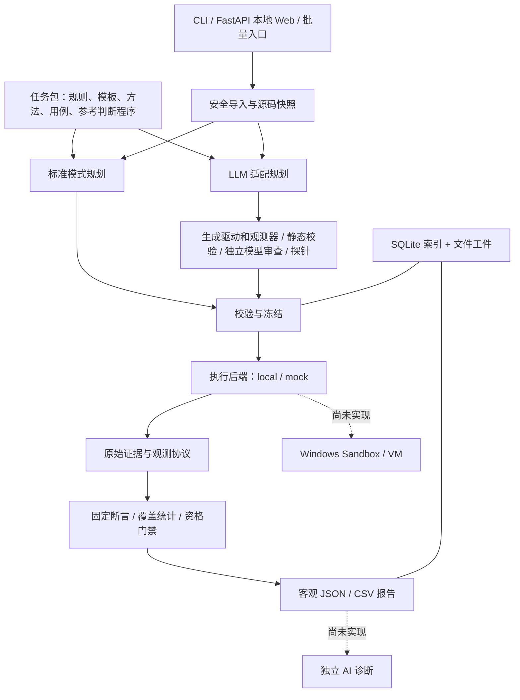

# 代码架构与计划书实施方案核查

核查日期：2026-10-21。对象：当前工作区 0.6.0 源码，包含已有未提交修改。依据：《工程实践项目任务书》《双模式测评系统架构与实施方案》v0.2。此次只增加核查报告，没有修改业务代码。

**总体判断**：项目已经形成“任务契约 → 测试规划 → 受控执行 → 真实观测 → 确定性断言 → 证据报告”的原型骨架。标准模式、LLM 适配模式及 Web 入口已有实现，但还不能认定任务书整体完成。阻断真实教学验收的主要缺口是：真实隔离后端、目标适配的权威校准/签审、独立 AI 诊断、10 题题库及真实模型评价。

现有设计值得保留：测试标准由题库决定；LLM 只能生成适配而不能评分；缺失观测不补答案；系统故障与学生错误分开；CHECKED 不自动成为正式成绩。后续应围绕这些边界补齐闭环。

**一、当前实际架构**

图中是逻辑职责。源码当前仍有两套较大的编排器，并非所有执行阶段都已经抽为同一个公共服务。

| 模块 | 当前实现与作用 | 对照方案的判断 | 建议优化 |
|---|---|---|---|
| 领域契约 `domain` | Pydantic 模型、枚举、哈希、规则、用例、计划、观测、报告；执行状态/比较结果/资格分开 | 核心契约已落地；ProjectAnalysis、完整 BindingMap 尚未独立实现 | 统一测试语义层级与目标程序形态的命名，避免 FUNCTION/WORKFLOW 和 FUNCTION/PROGRAM 混淆 |
| 提交导入 `intake` | 单文件、目录、ZIP；限额、路径校验、编码识别、原字节快照与哈希 | 主导入链较完整；批量入口另写解压逻辑，出现校验分叉 | 所有入口使用同一摄入服务；界面层只接收文件，不再负责解压 |
| 题库 `tasks`、`task_library` | 规则、Schema、测试方法、断言、正确/缺陷版本、包哈希、发布封存与校准 | 5 题、26 例；距至少 10 题且每题至少 4 例仍不足 | 分开公开探针、校准材料、正式验收用例；扩题时增加独立缺陷类型 |
| 标准模式 `orchestrator/runner.py` | 提交覆盖基准工程、固定驱动、构建、逐例运行、判断及报告 | 固定接口测评闭环已实现；不匹配接口会拒绝，不再降级成单条观察测试 | 明确“补丁提交”与“完整工程提交”契约，减少按文件基本名猜测覆盖位置 |
| LLM 提供者 `llm/provider.py` | JSON 请求、有限重试、调用预算、日志摘要、Key 处理 | 是适配生成客户端；不等于 AI 诊断，也不是完整工具调用 Agent | 保持受控调用，分开生成、审查、诊断用途与预算 |
| 适配规划 `planning`、`mode_two.py` | 基准方法及真实驱动输入、目标源码/差异、驱动与观测器生成、绑定、校验、审查、编译、探针、修正、冻结 | 核心迁移链已存在；分析与生成主要合并在一次 JSON 调用；完整源码索引/按需读取尚缺 | 先形成结构化工程分析，再生成适配；缓存以源码、模板、生成物及验证记录哈希为键 |
| 执行后端 `sandbox` | Win32 Job Object 资源控制和 mock；编译/运行请求接口；能力门禁 | 只有宿主受限进程与模拟器，无真实虚拟化隔离；普通上传被拒绝 | 补充会话创建、输入传递、结果回收、销毁/清理契约，再接真实隔离后端 |
| 判定内核 `judge`、`protocol` | 协议解析、观测提取、EQUALS/MULTISET_EQUALS/UNCHANGED、覆盖及总结果聚合 | 方向正确；缺观测、适配故障和低验证等级不直接判学生错 | 将“计划覆盖”“实际观测覆盖”“有效比较覆盖”分开显示；当前覆盖完整仍需结合 NOT_COMPARED 判断 |
| 可信验证 `tasks/calibration.py` | 读取当前任务/环境绑定的正确和缺陷参考报告，计算标准判断程序校准等级 | 标准题库校准存在；新目标适配最高 CHECKED，没有目标级校准或签审入口 | 为不可变 VerifierRevision 保存独立 ValidationRecord；源码或适配变化使旧授信失效 |
| 存储与复现 `storage`、`replay` | SQLite 索引、事件、文件证据；replay 新建运行、rejudge 仅重算观测 | 已区分重放和重判，优于旧文档；未形成完整恢复调度机制 | 引入轻量持久化作业状态；冻结工件、证据和新运行之间建立明确引用 |
| 交互 `interfaces` | CLI、本地 Web、上传、查询、取消、导出、串行批量、中英展示 | 基本界面具备；诊断页面只有占位；进程内单线程队列不等于可恢复队列 | 抽 ApplicationService 统一入口；用 SQLite 任务表支持重启后识别和恢复作业，无需分布式系统 |
| 参考自检 `selfcheck` | 用固定菜单脚本观察随附参考程序，单独报告 | 是开发验证辅助线，不是五道题完整评分，也不是通用自动适配 | 保留独立用途，避免与标准评分或 LLM 自动适配混用 |

**二、与任务书验收要求逐项对应**

| 要求 | 当前证据 | 结论 |
|---|---|---|
| 自动编译、执行、客观比较、JSON 报告 | 标准运行器、沙箱接口、协议和断言链存在 | 原型已实现，真实学生上传受隔离缺口限制 |
| 不可信代码在隔离环境运行 | local 明确缺少网络和文件系统隔离；make_backend 仅 local/mock | 未完成；拒绝上传是在保护边界，不能算隔离已经交付 |
| 至少 10 道题、每题至少 4 例 | 当前 4 + 6 + 6 + 5 + 5 = 26 例，共 5 题 | 部分完成；还需至少新增 5 题，每题不少于 4 例 |
| AI 错误位置、原因、修改建议、边界提示 | 没有独立诊断模型/作业/报告；Web 为占位文案 | 未完成；适配生成不能替代此项 |
| 本地 Web 选择、上传、结果、诊断、导出 | 除诊断外主要入口存在 | 部分完成，上传执行还依赖真实隔离 |
| 至少 10 份已知错误程序的诊断评价 | 当前无已完成诊断链；旧实验报告主要验证标准测评 | 未完成，不能以适配测试替代诊断评价 |
| 完整模式二 | 生成、验证、试跑、修正、冻结、试测已建；目标授信、缓存、等待恢复、真实模型评价不完整 | 可定位为探索性原型，不能宣称通用自动验收 |

**三、本次确认的具体问题与方案偏差**

**1. 优先修复：批量 ZIP 导入没有复用主路径策略。**

证据：`interfaces/web/batch.py:53` 使用 PurePosixPath 检查绝对路径和 drive；`:114` 随后用 Windows Path 拼接并写入文件。`interfaces/web/app.py:943` 附近在提交测评之前调用该解压流程，所以后面的执行能力门禁不能保护这一步。

本次直接提取现有 `_safe_member` 函数进行无文件写入的路径计算：

| ZIP 内名称 | 校验结果 | 以 C:/audit/programs/p1/source 为根拼接 |
|---|---|---|
| C:/audit/outside.cpp | 接受 | C:/audit/outside.cpp，越出根目录 |
| D:/audit/outside.cpp | 接受 | D:/audit/outside.cpp，越出根目录 |
| safe/main.cpp | 接受 | 留在根目录 |
| main.cpp:stream | 接受 | 未拒绝 Windows 备用数据流语法 |
| NUL.cpp | 接受 | 未拒绝 Windows 保留设备名 |

这不是完整恶意 ZIP 写入实验，但已确认校验与路径拼接的错误组合。建议批量入口直接复用 `intake/snapshot.py` 和 `intake/path_policy.py`，统一盘符、设备名、重复路径、实际解压大小及链接策略；写入前再验证解析后的目标位于快照根目录。

**2. 公开探针与正式测试数据尚未真正分离。**

实施方案 §3.2、§5.8 要求生成阶段只拿获准探测输入，使用 PROBE 用例验证适配。实际 `mode_two.py:463` 将 task_spec.case_ids 对应的全部输入放入提示词；`:663–676` 选第一条正式用例，复制并改名为 probe。当前 26 个用例的 purpose 全部为 ASSESSMENT。

目前没有因此泄露 expected，也没有用探针比较学生答案，这是已实现的正确边界。但“不同 case_id”不代表独立探针数据。建议为生成阶段提供公开样例与契约；探针覆盖合法、拒绝和初始化等必要观测路径；正式数据冻结后才交执行器。一般性适配优先参数化会话，确需 session_by_case 时限定公开范围，降低针对固定用例编写行为的空间。

**3. 语义映射和工程分析仍比方案简化。**

`planning/bundle.py:202` 的 SourceBinding 只有 ACTION/OUTPUT、文件、片段及符号；方案要求的 SETUP/INPUT/TEARDOWN、转换标识、文件哈希和行号并未完整表达。当前按原文片段与符号是否存在进行校验，只能证明引用存在，不能证明生成代码一定调用了正确业务路径。

`domain/enums.py` 的 SubjectLevel 是 FUNCTION/WORKFLOW，而 `planning/bundle.py:84` 使用 FUNCTION/PROGRAM。建议拆成“被测行为层级”和“目标工程形态”两个独立字段，统一明确业务流程要求，避免日后把调用方式和验收范围混为一谈。保持 CHECKED 限制，不能用增加提示词代替授信证据。

**4. 执行编排和界面职责偏重。**

本次统计：标准运行器 1653 行，模式二运行器 1327 行，Web 应用 1041 行。行数本身不是缺陷；问题在于两运行器都承担预算、阶段状态、编译、用例执行、证据、报告与异常收尾。Web 又承担上传预处理和批次调度，已经出现独立解压策略分叉。

建议按职责渐进拆分：StandardPlanner/LlmPlanner 负责产生计划，公共 Executor 执行冻结计划，Judge 保持纯判定，EvidenceStore 统一工件，RunService 负责生命周期。不要直接合并成更大的条件分支，也不要一开始上微服务或多 Agent。

**5. 后端抽象尚不足以完整承载隔离生命周期。**

`sandbox/base.py` 只有 capabilities/compile/run。对于计划书要求的隔离启动、数据只读传入、结果取回、跨用例清理和失败回收，尚缺显式生命周期契约。现有 gate 已正确拒绝普通上传；优化应补足后端，不能放宽 gate。

**6. 文档、旧逻辑和依赖说明存在漂移。**

README 已是 0.6.0；设计说明和阶段总结仍有“标准模式不匹配时走观察型”“CHECKED 可参与判定”等旧阶段描述；runner 中仍保留 legacy 分支及过时提示。旧实验报告把 replay 描述为重算观测，当前代码已将其分成 replay/rejudge。应明确标注历史报告适用版本，并维护一份现状矩阵。

另外，pyproject.toml 已声明 Web 与开发依赖，而 requirements.txt/requirements-dev.txt 仍只包含早期核心依赖及 pytest。建议以一份依赖定义为准生成其他安装入口，记录经过验证的运行环境；否则不同安装方式会得到不同能力。

**四、建议的优化方向与推进顺序**

**第一批：把真实使用的阻断项补齐。** 修复批量导入分叉；实现一个可验证的真实隔离后端，并覆盖编译、执行、结果回收及清理。验收标准是普通上传在隔离中完成闭环，同时确认网络、宿主路径、进程树和资源限制有效。

**第二批：完成任务书基础交付。** 扩充到 10 题，每题至少 4 例；独立开发诊断作业，输入任务、相关源码、编译日志、失败证据，输出位置、原因、建议、边界检查及证据 ID。先保存客观报告，诊断 API 失败只影响诊断状态。对至少 10 份已知错误程序进行教师评价。

**第三批：补齐模式二的可信闭环。** 分开公开探针、校准和正式验收数据；引入目标 VerifierRevision 与 ValidationRecord。已有可信接口族走自动正反例校准；没有兼容参考的工程保持试测，允许审核者对指定生成物版本签审。通过记录计算等级，不让模型自报可信。

**第四批：降低长期维护与适配成本。** 逐步抽取公共执行内核；统一导入服务；用 SQLite 作业表替代仅存在内存里的队列状态；增加结构化分析与按需源码读取。最后再做适配缓存，缓存资格必须绑定源码、方法、编译环境、生成物和验证证据，不能凭项目名复用。

**实验设计也应调整。** 不能只看“模型有没有生成代码”和最终成功案例。至少按题目、程序结构、驱动策略记录：首次生成可用率、修正后可用率、最终覆盖、误接受/误拒绝、无法适配比例、人工复核时间、总耗时与 token。校准样本与最终验证样本分开。自动化集成测试中的固定模型响应验证工程链路，真实模型实验验证适配能力，两者分别报告。

**五、验证范围与证据强度**

- 本次读取两份企划书、当前核心源码、任务包、测试定义和历史修复/实验资料；以当前工作区文件而非 Git HEAD 为准。
- 本次对 src/tests/tools 下 79 个 Python 文件完成 AST 语法解析，全部成功；这不等于依赖可用或运行逻辑测试通过。
- 本次直接统计任务 JSON：5 题、26 例，全部标为 ASSESSMENT。
- 本次对批量路径函数完成纯路径复现，没有解压恶意文件或写入工作区外路径。
- 当前可用的内置 Python 缺少 pytest、fastapi、jsonschema、httpx，系统 Python 启动器未找到安装环境；没有重跑完整回归，也没有安装依赖或调用真实模型 API。
- 仓库 `data/fix-tests-final.txt` 保存“166 passed, 1 warning”，是此前执行记录，不能表述为本次运行结果。
- 当前 LLM 集成测试使用 FakeClient 返回固定 JSON，再用真实 C++ 编译链检查生成物。这支持受控场景链路的可测性，不证明真实模型对不同学生工程的成功率。

**关键源码索引**：`orchestrator/runner.py:168,451,607`；`orchestrator/mode_two.py:267,448,663,1199,1217`；`planning/bundle.py:84,202,333`；`sandbox/base.py`、`sandbox/gate.py`、`sandbox/local.py:47`；`tasks/calibration.py:14`；`judge/aggregate.py:94`；`interfaces/web/batch.py:53,114`；`interfaces/web/app.py:324,893`；`orchestrator/replay.py:16`。上述路径均以仓库 `src/cpp_assessor/` 为根。
